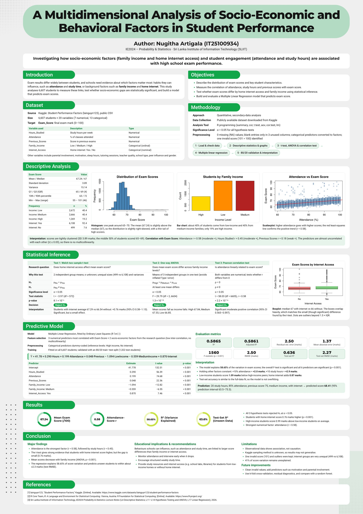
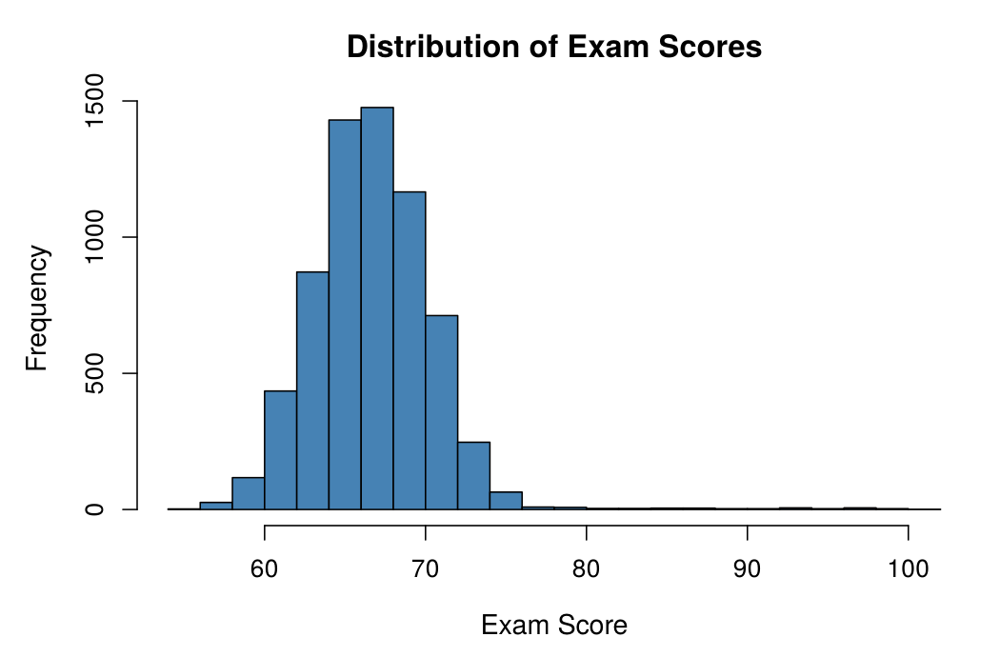
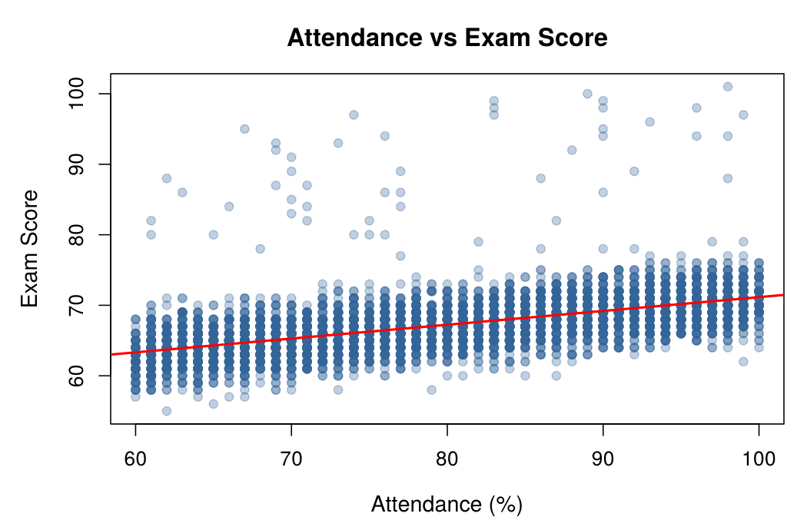
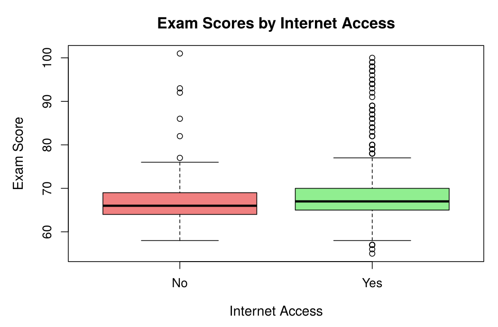
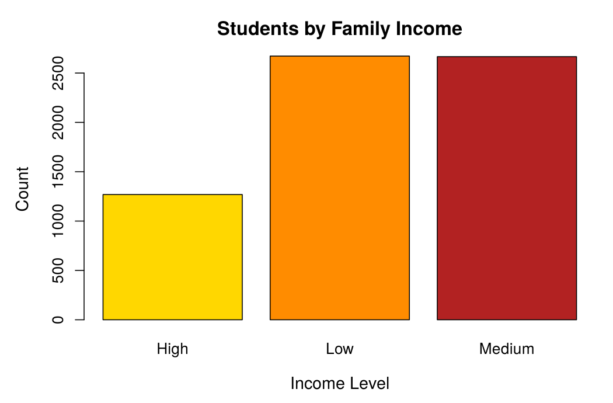

# Student Performance Analysis in R

**A Multidimensional Analysis of Socio-Economic and Behavioral Factors in Student Performance**

Statistical analysis and predictive modelling project for the **IE2024 – Probability and Statistics** module at the **Sri Lanka Institute of Information Technology (SLIIT)**.



📄 [View the full A1 poster (PDF)](poster.pdf)

---

## Overview

What drives high school exam performance: habits that schools can influence, or students' family background?

This project uses R to analyse **6,607 students** and measure how **behavioural factors** (attendance, study hours) and **socio-economic factors** (family income, home internet access) are associated with exam scores. It covers the full workflow: data checks, descriptive statistics, hypothesis testing, and a validated predictive model.

## Dataset

| | |
|---|---|
| **Source** | [Student Performance Factors – Kaggle (lainguyn123)](https://www.kaggle.com/datasets/lainguyn123/student-performance-factors) |
| **Size** | 6,607 students × 20 variables (7 numerical, 13 categorical) |
| **Target** | `Exam_Score` (final exam mark, 0–100) |
| **Predictors used** | `Hours_Studied`, `Attendance`, `Previous_Scores`, `Family_Income`, `Internet_Access` |

The dataset is not included in this repository. Download `StudentPerformanceFactors.csv` from the Kaggle link above.

## Methods

1. **Data quality checks:** missing values, blank entries, invalid scores; categorical variables converted to factors
2. **Descriptive statistics:** mean, median, standard deviation, variance, quartiles, IQR, frequency tables and a correlation matrix
3. **Visualisation:** histogram, boxplot, scatterplot with regression line, and bar chart
4. **Statistical inference** (α = 0.05):
   - Welch two-sample t-test: exam score by internet access
   - One-way ANOVA: exam score by family income
   - Pearson correlation test: attendance vs exam score
5. **Predictive modelling:** multiple linear regression (OLS), evaluated with R², adjusted R², RMSE and MAE, and validated on an 80/20 train–test split

## Key Results

### Hypothesis tests

| Test | Statistic | p-value | Decision |
|---|---|---|---|
| Welch t-test (internet access) | t = −3.97 | 8.1 × 10⁻⁵ | Reject H₀ |
| One-way ANOVA (family income) | F = 29.79 | 1.3 × 10⁻¹³ | Reject H₀ |
| Pearson correlation (attendance) | r = 0.58, t = 58.03 | < 2.2 × 10⁻¹⁶ | Reject H₀ |

### Regression model

| Metric | Value |
|---|---|
| R² | 0.5865 |
| Adjusted R² | 0.5861 |
| RMSE | 2.50 marks |
| MAE | 1.37 marks |
| Test-set R² (unseen 20%) | 0.636 |
| Test-set RMSE | 2.27 marks |

### Findings

- **Attendance** had the strongest relationship with exam scores (r = 0.58), followed by study hours (r = 0.45).
- Students with **home internet** scored higher on average: a statistically significant but small difference of 0.76 marks.
- Mean scores **decreased with family income**: High 67.84, Medium 67.33, Low 66.85.
- Holding other factors constant, **+10% attendance ≈ +2.0 marks** and **+10 study hours ≈ +2.9 marks**.
- The model performed consistently on unseen data, so it is not overfitting.

## Visualisations

| | |
|---|---|
|  |  |
|  |  |

## How to Run

1. Install [R](https://www.r-project.org/) (and optionally [RStudio](https://posit.co/download/rstudio-desktop/)). No extra packages are needed; the script uses base R only.
2. Download `StudentPerformanceFactors.csv` from Kaggle and place it in the same folder as `Final_R.R`.
3. Run the script:
   - In RStudio: open `Final_R.R`, set the working directory to its folder, and click **Source**.
   - In a terminal: `Rscript Final_R.R`

The console prints every result in order (Task 1 → Task 4), and the four plots are drawn.

## Repository Structure

```
├── Final_R.R                      # Full analysis script (Tasks 1–4)
├── README.md                      # This file
├── poster.pdf                     # A1 research poster
├── poster.jpg                     # Poster preview image
├── histogram_exam_scores.png
├── boxplot_internet_access.png
├── scatter_attendance.png
└── barplot_family_income.png
```

## Limitations and Future Work

- Observational data shows association, not causation.
- The dataset's sampling method is not documented, so results may not generalise.
- One invalid score (101) and outliers were kept; internet-access groups are very unequal in size.
- Future work: clean invalid values, add predictors such as motivation and parental involvement, use k-fold cross-validation and residual diagnostics, and compare with tree-based models.

## Acknowledgements

Completed for **IE2024 – Probability and Statistics**, Sri Lanka Institute of Information Technology (SLIIT).
Thank you to the Lecturer in Charge, **Samadhi Chathuranga Rathnayake**, for the guidance throughout the module.

## Author

**Nugitha Artigala**
Undergraduate, Sri Lanka Institute of Information Technology (SLIIT)
